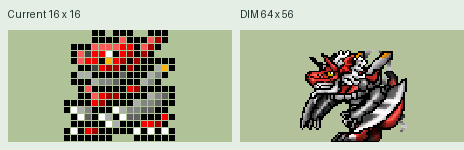

# DigiPocket for CoreS3

[简体中文](README_cn.md) · [Offline evolution chart](进化路线图.html)

This repository contains the CoreS3 firmware, browser edition and a monochrome sample roster: the Agumon egg, Botamon, and Koromon's complete ordinary evolution branch.

From the repository root, run `python3 -m http.server 8000`, then open `http://localhost:8000/web/`. A selects, B confirms, and C goes back. Open the evolution chart directly in a browser for offline reference.

Optional DIM and expanded sprite packs are distributed separately.

## Screenshots

**Battle animation**

**DIM sprite pack preview**

**MegaloGrowmon: classic and DIM**

The DIM images show the optional resource pack. [Open the offline evolution chart](进化路线图.html).

## Install on CoreS3

1. Install Python 3 and PlatformIO Core (`python3 -m pip install --user platformio`). Make sure `pio --version` works.
2. Connect your M5Stack CoreS3 with a USB data cable. Back up your existing device before upgrading.
3. From the repository root, run `./烧录到CoreS3.command` on macOS, or `pio run -d firmware -e cores3 -t upload` on other platforms. To choose the serial port explicitly, add `--upload-port <port>`.
4. After upload, restart the device. The embedded monochrome roster is available without an SD card. Press A to select, B to confirm, and C to go back. Hold A on the home screen to open the extended menu.

For a compile-only check, run `pio run -d firmware -e cores3`. The firmware was compiled locally. The upload script was syntax-checked without a physical device.

## Optional SD card resources

Extract the separately distributed resource pack. Back up any existing `digipet` folder on the FAT32 microSD card, then copy the extracted `sdcard/digipet` folder to the card root. The resulting layout must contain `/digipet/catalog.tsv`, `/digipet/database/` and, when provided, `/digipet/dim/` and `/digipet/sound/`. Do not copy the outer `sdcard` folder itself.

On macOS, you can also use `./复制素材到SD卡.command "/path/to/extracted/sdcard/digipet" "/Volumes/SDCARD"`. The helper checks the copied files and backs up the existing resource directory before replacing it. Eject the card, insert it in the CoreS3, and restart. Choose DIM COLOR in Settings to use available DIM sprites.

## Local development with the full resource set

Edit shared source in the repository root. In the migrated checkout, the original local resources are under the ignored `local/original/` directory. Run `python3 tools/prepare-full.py` to stage the current tracked source and full resources in `local/full-build/`. Regenerate that build directory after editing the shared source.
