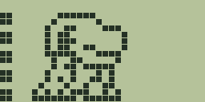
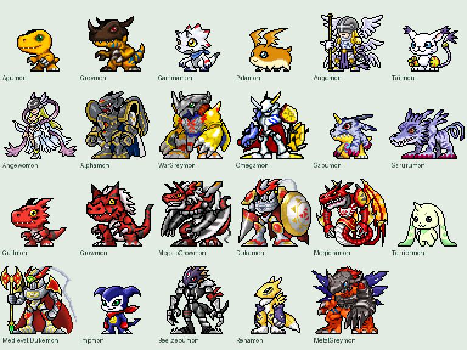
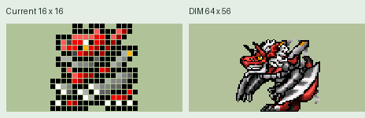

# DigiPocket 暴龙机

[English](README.md) · [离线进化路线图](web/进化路线图.html)

仓库包含 CoreS3 固件源码、网页版源码和黑白示例素材，覆盖数码蛋、黑球兽及滚球兽的完整普通进化分支。

在仓库根目录运行 `python3 -m http.server 8000`，浏览器打开 `http://localhost:8000/web/`。A 选择，B 确认，C 返回。进化路线图可以直接用浏览器离线打开。

DIM 和分支外的素材另行打包。

## 画面预览

**经典战斗动画**

**DIM 素材总览**

**大古拉兽的经典与 DIM 画面对比**

DIM 图片展示可选素材包的效果。[打开离线进化路线图](web/进化路线图.html)。

## 烧录到 CoreS3

1. 安装 Python 3 和 PlatformIO Core（`python3 -m pip install --user platformio`），确认终端能运行 `pio --version`。
2. 用 USB 数据线连接 CoreS3。升级已有设备前，请先备份设备数据。
3. 在仓库根目录运行 `./烧录到CoreS3.command`（macOS）。其他系统可运行 `pio run -d firmware -e cores3 -t upload`。有多个串口时可在末尾加 `--upload-port <串口>`。
4. 烧录结束后重启。没有 SD 卡也能玩内置的黑白分支。A 选择，B 确认，C 返回。主画面长按 A 打开扩展菜单。

只编译时运行 `pio run -d firmware -e cores3`。当前版本已在电脑上编译，烧录脚本通过语法检查，未连接设备实测。

## 复制可选素材到 SD 卡

解压独立素材包，备份 FAT32 microSD 卡上已有的 `digipet` 文件夹，然后把解压后的 `sdcard/digipet` 复制到卡根目录。确认卡上存在 `/digipet/catalog.tsv` 和 `/digipet/database/`。素材包内的 `dim/` 和 `sound/` 也放在 `digipet/` 下。不要把外层 `sdcard` 文件夹一起复制进去。

macOS 也可运行 `./复制素材到SD卡.command "/解压目录/sdcard/digipet" "/Volumes/卡名"`。脚本会核对复制结果，替换前备份已有的素材目录。复制完成后安全弹出，插回 CoreS3 并重启。在设置中切换到 DIM COLOR，即可显示资源包里有对应素材的角色。

## 本地完整素材版开发

统一在仓库根目录修改源码。已迁移的完整资源保存在 Git 忽略的 `local/original/`。运行 `python3 tools/prepare-full.py`，可将当前受 Git 跟踪的源码和本地完整资源组合到 `local/full-build/`。该目录是构建输出。在根目录修改源码后，请重新生成完整构建目录。
